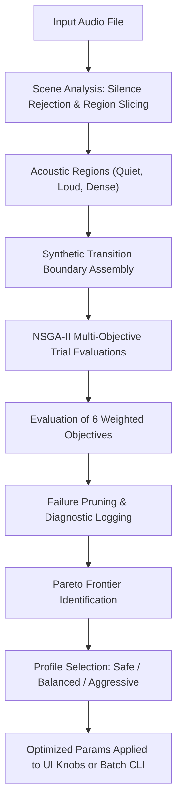

# Auto-Tune & NSGA-II Multi-Objective Optimizer

Audio restoration is fundamentally a trade-off problem: the more aggressively an algorithm removes unwanted noise or shimmer, the greater the risk of dulling musical transients, hollowing out harmonics, or collapsing stereo width. Deshimmer solves this dilemma using an automated scene analyzer and an evolutionary **NSGA-II multi-objective optimizer** powered by Optuna, located in [src/deshimmer/autotune/](file:///Users/theapemachine/go/src/github.com/theapemachine/deshimmer/src/deshimmer/autotune/).

---

## 1. Why Multi-Objective Optimization?

Single-objective optimization (e.g. minimizing high-frequency energy or minimizing RMS difference against silence) inevitably leads to trivial, destructive solutions: muting the track entirely or applying extreme low-pass filtering. 

Deshimmer treats audio artifact reconstruction as a **constrained multi-objective search**. The optimizer explores parameter space to discover the **Pareto frontier**—the set of non-dominated parameter configurations where no single objective (such as artifact reduction) can be improved without degrading another (such as transient clarity or stereo width).



---

## 2. Automatic Scene Analysis (`analyze`, `pick_regions`)

Before running optimization trials, Deshimmer inspects the input audio in [analyzer.py](file:///Users/theapemachine/go/src/github.com/theapemachine/deshimmer/src/deshimmer/autotune/analyzer.py):

### 2.1 Silence Rejection & Dynamic Range Slicing
- Scans RMS energy across 100 ms frames with a -60 dBFS noise gate to exclude lead-in silence and digital zero padding.
- Computes energy percentiles ($P_{10}, P_{50}, P_{90}$) to categorize dynamic variation across the track.
- Selects representative `Region` spans (e.g. 1.0 to 3.0 seconds each) capturing contrasting acoustic environments:
  - **Quiet / sparse region**: High sensitivity to background hiss, reverb tails, and stationary whines.
  - **Loud / dense region**: High sensitivity to transient dulling, cymbal masking, and compression pumping.

### 2.2 Resonance & Shimmer Pre-Detection
- Computes background Power Spectral Density (PSD) using Welch's method.
- Identifies prominent stationary resonance peaks and suggests initial center frequencies (`deq_start_hz`, `deq_end_hz`) and shimmer band boundaries (`start_hz`, `end_hz`).

---

## 3. The Six Weighted Objectives

During each optimizer trial, the candidate `Params` configuration is evaluated across the selected regions and scored against six distinct objective functions defined in [scoring.py](file:///Users/theapemachine/go/src/github.com/theapemachine/deshimmer/src/deshimmer/autotune/scoring.py):

| Objective Group | Optimization Direction | Key Metrics Included | Purpose |
|:---|:---:|:---|:---|
| **1. Artifact Reduction** | **Maximize** | `band_reduction_db`, `swish_reduction` | Measures depth of attenuation specifically inside the target problem bands (e.g. 5.1–7.2 kHz). |
| **2. Music Preservation** | **Minimize Penalty** | `out_of_band_change_db`, `musical_noise`, `band_energy_loss_db`, `centroid_shift` | Penalizes unintended modifications to audio frequencies outside the designated repair bands. Penalizes variance in quiet frames ("musical noise"). |
| **3. Diff Leakage** | **Minimize Penalty** | `transient_leak`, `harmonic_leak`, `diff_onset_corr` | Analyzes the *difference signal* ($x_{\text{input}} - y_{\text{processed}}$). Any presence of sharp transients or prominent musical harmonics in the diff indicates damage to the source music. |
| **4. Stereo Integrity** | **Minimize Penalty** | `stereo_width_delta` | Measures inter-channel cross-correlation difference between dry and wet signals, preventing mono collapse or phase distortion. |
| **5. Dynamic Balance** | **Minimize Penalty** | `loudness_loss_db`, `spectral_tilt_delta` | Prevents overall track volume loss and unnatural darkening of the tonal spectrum. |
| **6. Tonal Coherence** | **Maximize** | `tonal_coherence_gain` | Quantifies harmonic alignment across detected partial families via `HarmonicField`. |

### Mathematical Metric Formulations
- **Diff Onset Correlation (`diff_onset_corr`)**: Computes normalized cross-correlation of half-wave rectified onset strength envelopes between the original input $x$ and the removed diff $d = x - y$:
  $$r_{\text{onset}} = \frac{\sum_n O_x[n] O_d[n]}{\sqrt{\sum_n O_x[n]^2 \sum_n O_d[n]^2}}$$
  A non-zero $r_{\text{onset}}$ indicates that musical note attacks were partially stripped into the diff.
- **Musical Noise Variance (`musical_noise`)**: Evaluates temporal variance of the spectral envelope in frames where the input is stationary. High variance indicates artificial fluttering or swirling artifacts.

---

## 4. Transition-Aware Evaluation (`build_synthetic_transition`)

Independent multi-region evaluation risks finding parameters that perform well in isolated slices but cause jarring gain jumps or audible pumping at transitions between quiet verses and loud choruses.

Deshimmer addresses this by constructing a **synthetic transition seam** in [optimizer.py](file:///Users/theapemachine/go/src/github.com/theapemachine/deshimmer/src/deshimmer/autotune/optimizer.py):
1. Takes the trailing 250 ms of a quiet region and the leading 250 ms of a loud region.
2. Cross-fades the junction to create a continuous seam.
3. Evaluates parameter behavior across this boundary using `score_transition_boundary`.
4. Penalizes sudden discontinuities in RMS level, spectral flux spikes, and envelope pump factors.

---

## 5. Pareto Frontier Selection (`_pick_pareto_trial`)

After the Optuna study completes its configured trials (e.g. 15–50 iterations), the Pareto frontier contains multiple valid non-dominated candidates. Deshimmer provides three user-selectable selection modes:

```python
# Balanced (Knee-point selection maximizing aggregate utility score)
best_trial = _pick_pareto_trial(study, mode="balanced")

# Safe (Prioritizes zero diff leakage and zero out-of-band coloration)
safe_trial = _pick_pareto_trial(study, mode="safe")

# Aggressive (Prioritizes maximum artifact reduction for heavily degraded audio)
aggressive_trial = _pick_pareto_trial(study, mode="aggressive")
```

The `aggressiveness` slider in the UI (ranging from 0.0 to 1.0) continuously blends the objective weights between the conservative preservation profile and the aggressive suppression profile.

---

## 6. Failure Pruning & Diagnostic Logging (`EvaluationFailureLog`)

In automated hyperparameter search, invalid parameter combinations or extreme filter gains can occasionally cause numerical overflow (NaN/Inf) or singular matrices during FFT inversion.

- Rather than crashing the study or returning synthetic "zero" scores that corrupt the evolutionary population distribution, Deshimmer catches runtime mathematical exceptions.
- Offending trials are pruned and recorded to a structured JSON diagnostic log (`auto_tune_debug/failures.json`) via `EvaluationFailureLog`.
- The study continues uninterrupted with clean, verified parameter populations.
