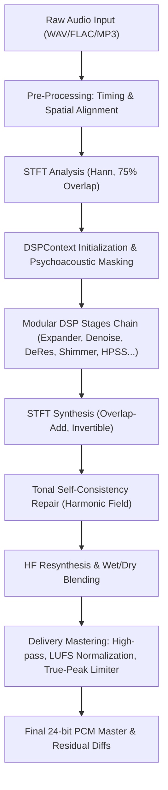

# Core DSP Architecture & Processing Pipeline

Deshimmer employs a modular, psychoacoustically bounded digital signal processing (DSP) architecture designed specifically to address high-frequency artifacts common in AI music generators (e.g. Suno, Udio) and aggressive lossy audio codecs. Rather than applying destructive broad EQ cuts or aggressive static lowpass filtering, Deshimmer isolates anomalous spectral energy while preserving natural musical transients, harmonics, and stereo width.

---

## 1. Architecture Overview

Processing is coordinated through three foundational classes in [src/deshimmer/core/](file:///Users/theapemachine/go/src/github.com/theapemachine/deshimmer/src/deshimmer/core/):

- **`DSPContext`** ([context.py](file:///Users/theapemachine/go/src/github.com/theapemachine/deshimmer/src/deshimmer/core/context.py)): A unified execution context holding the Short-Time Fourier Transform (STFT) matrix $Z \in \mathbb{C}^{F \times T \times C}$, temporal and spectral measurement caches, psychoacoustic masking thresholds, and the cumulative stage attenuation mask $g_{\text{total}} \in [0, 1]^{F \times T}$.
- **`DSPStage`** ([stages/base.py](file:///Users/theapemachine/go/src/github.com/theapemachine/deshimmer/src/deshimmer/core/stages/base.py)): Abstract base class defining stage lifecycle hooks: `is_enabled()`, `prepare()`, and `process()`.
- **`DSPPipeline`** ([pipeline.py](file:///Users/theapemachine/go/src/github.com/theapemachine/deshimmer/src/deshimmer/core/pipeline.py)): An ordered container of stages executed sequentially over `DSPContext`. Stages can be reordered, isolated, or benchmarked independently.

---

## 2. Pre-Processing: Spatial Conditioning

Before entering the time-frequency domain, multi-channel signals pass through two spatial conditioning stages in [spatial.py](file:///Users/theapemachine/go/src/github.com/theapemachine/deshimmer/src/deshimmer/core/spatial.py):

### 2.1 Inter-Channel Delay Alignment (`align_lr_delay`)
Codec and AI generation artifacts frequently exhibit slight inter-channel phase skews that cause unnatural comb filtering and stereo blur.
- Calculates the normalized cross-correlation between left and right channels:
  $$R_{LR}[k] = \sum_n L[n] R[n+k]$$
- Searches within a strict 3.0 ms window ($\approx 132$ samples at 44.1 kHz) to avoid shifting musical delays across separate instruments.
- If a dominant correlation peak exists with sufficient confidence, the lagging channel is advanced to align phase coherence.

### 2.2 Spectral Balance (`balance_lr_spectrum`)
- Calculates the average log-frequency spectral tilt between left and right channels using linear regression.
- Applies gentle shelving correction when inter-channel tilt exceeds configured tolerance thresholds, stabilizing the phantom center image.

---

## 3. Time-Frequency Framing: STFT Engine

Deshimmer operates in a high-resolution Short-Time Fourier Transform frame:
- **Default FFT Size (`n_fft`)**: 2048 bins (46.4 ms at 44.1 kHz), providing $\approx 21.5\text{ Hz}$ frequency resolution.
- **Default Hop Size (`hop`)**: 512 bins (75% overlap), ensuring smooth temporal transitions and zero time-domain aliasing.
- **Window Function**: Periodic Hann window with exact constant-overlap-add (COLA) compliance.
- **Invertibility Guarantee**: In the absence of attenuation ($g=1.0$), synthesis via inverse STFT reproduces input samples within floating-point precision ($< 10^{-7}\text{ atol}$).

---

## 4. Psychoacoustic Masking Engine

To prevent the introduction of audible musical noise or dulling during attenuation, Deshimmer computes psychoacoustic masking bounds in [psychoacoustic.py](file:///Users/theapemachine/go/src/github.com/theapemachine/deshimmer/src/deshimmer/core/psychoacoustic.py):

### 4.1 Absolute Threshold of Hearing (ATH)
An approximation of the human hearing threshold in quiet across frequency $f\text{ (kHz)}$:
$$T_q(f) = 3.64 \left(\frac{f}{1000}\right)^{-0.8} - 6.5 e^{-0.6\left(\frac{f}{1000} - 3.3\right)^2} + 10^{-3}\left(\frac{f}{1000}\right)^4\text{ [dB SPL]}$$
Sub-20 Hz frequencies are clamped to prevent numerical overflow.

### 4.2 Spreading Function & Forward Temporal Masking
- **Spectral Spreading**: Energetic peaks mask neighboring frequency bins via triangular spreading curves (accounting for steeper upward masking slopes and gentler downward slopes on the basilar membrane).
- **Forward Temporal Masking Decay (`apply_temporal_masking_decay`)**:
  - High-energy events mask quiet content occurring within 10–20 ms after the onset.
  - Implemented via a fast Numba JIT exponential decay loop.
  - **Spectral Flatness Gating**: When a frame's spectral flatness is below `flat_start` (indicating a sustained tonal resonance rather than a broadband transient), temporal masking decay is collapsed, preventing masking bleed from shielding persistent whines.

---

## 5. Stage-by-Stage Processing Chain

The default processing pipeline constructs 10 specialized stages in [stages/](file:///Users/theapemachine/go/src/github.com/theapemachine/deshimmer/src/deshimmer/core/stages/):

### Stage 1: Downward Expander (`ExpanderStage`)
- **Target**: Low-level high-frequency noise and residual hiss in quiet passages.
- **Operation**: Evaluates RMS level within `exp_start_hz` to `exp_end_hz`. If energy falls below `exp_threshold_db` (default -45 dB), it attenuates the band with a configurable `exp_ratio` (default 2.0).
- **Smoothing**: One-pole attack (`exp_attack_ms`) and release (`exp_release_ms`) envelopes prevent breathing artifacts.

### Stage 2: Minimum-Statistics Denoiser (`DenoiseStage`)
- **Target**: Stationary broadband background noise, hiss, and codec swish.
- **Floor Tracking**: Uses a sliding time window minimum-statistics tracker (`dn_minwin_ms`) to estimate the true stationary noise floor per bin without requiring a separate noise print.
- **Suppression**: Implements over-subtraction with a hard safety floor (`dn_floor_db`) and frequency smoothing across neighboring bins (`dn_freq_smooth_bins`) to eliminate isolated "musical noise" chirps.

### Stage 3: Smart De-Resonator (`DeResonatorStage`)
- **Target**: Narrowband stationary whines and metallic resonances (e.g. 3.5 kHz whistles common in Suno outputs).
- **Peak Discrimination**: Computes local frequency median over `deq_freq_med_bins` (default 61 bins). Prominent spectral peaks that exceed the local median by `deq_thr_db` and persist for longer than `deq_persist_ms` are flagged.
- **Time-Stabilized Floor**: When `deq_time_floor` is enabled, a running time floor tracks the stationary baseline with a bounded rise rate (`deq_floor_rise_db_per_s`), preventing attenuation on genuine vibrato or musical notes.
- **Dynamic Attenuation**: Scales attenuation up to `deq_max_att_db` with smooth Hann transitions at the edges.

### Stage 4: Shimmer Suppression (`ShimmerSuppressionStage`)
- **Target**: Metallic "sparkle" and unnatural high-frequency energy modulation in the 5.1–7.2 kHz band.
- **Dual-Threshold Spectral Flux**: Computes positive frame-to-frame spectral flux:
  $$\Delta P[f, t] = \max(0, P[f, t] - P[f, t-1])$$
- **Flatness Discrimination**: Computes Wiener spectral flatness ($g_m / a_m$). Frames exhibiting high flux combined with intermediate flatness values (indicating unnatural synthetic shimmer rather than clean cymbals or pure noise) are subjected to attenuation controlled by `thr_db` and `slope`.

### Stage 5: Swish Repair (`SwishRepairStage`)
- **Target**: Low-bitrate phase cancellations and swirling phase noise in upper mids.
- Detects rapid phase incoherence across frames and smooths erratic phase jumps while preserving energy envelopes.

### Stage 6: Harmonic-Percussive Separation (`HPSSStage`)
- **Target**: Separation of sustained harmonic tones from transient drum hits.
- Executes 2D median filtering across the spectrogram (horizontal median filter across time frames for harmonic content; vertical median filter across frequency bins for percussive transients).
- Protects sharp percussion attacks from being dulled by subsequent spectral smoothing stages.

### Stage 7: Noise Resynthesis (`NoiseResynthesisStage`)
- **Target**: Vitreous, crystalline audio textures caused by clustered phase quantization.
- In frames classified as noise-like (via flatness and harmonic confidence), subtle random-phase noise is blended into the magnitude envelope controlled by `noise_resynth` (0.0 to 1.0). This replaces harsh digital sparkle with natural acoustic air.

### Stage 8: Phase Blur (`PhaseBlurStage`)
- **Target**: Artificial phase coherence artifacts across high-frequency bands.
- Injects small, bounded phase dispersion in high frequencies without altering magnitude envelopes, preventing comb filtering.

### Stage 9: Dynamic Spectral Carver (`DynamicCarverStage`)
- Broadcasts multi-bin adaptive smoothing to carve out unnatural resonant shelves across stereo channels.

### Stage 10: Gain Application (`GainApplicationStage`)
- Accumulates all individual stage gain matrices into a unified composite attenuation map:
  $$g_{\text{total}}[f, t] = \prod_i g_i[f, t]$$
- Multiplies the complex STFT matrix: $Z_{\text{out}}[f, t, c] = Z[f, t, c] \cdot g_{\text{total}}[f, t]$.

---

## 6. High-Frequency Resynthesis (`hf_resynth_post`)

In severely band-limited or over-filtered material where top-end air has been lost, Deshimmer can synthesize natural high-frequency harmonics:
- **Source Band**: Takes clean mid-frequency signal from `hf_src_lo_hz` to `hf_src_hi_hz` (e.g. 1–2 kHz).
- **Non-Linear Excitation**: Passes the source through smooth non-linear saturation (`hf_drive`) to generate harmonic overtones.
- **High-Pass & Tilt Filter**: Filters the generated overtones with a high-pass filter (`hf_hp_hz`) and applies a subtle spectral tilt curve.
- **Zero-Phase Mode**: Optionally applies zero-phase forward-backward filtering to prevent phase smearing.

---

## 7. Delivery Mastering

When `master_params.enabled=True`, processed audio passes through a clean studio mastering chain in [mastering.py](file:///Users/theapemachine/go/src/github.com/theapemachine/deshimmer/src/deshimmer/core/mastering.py):

1. **Subsonic High-Pass Filter**: 2nd-order Butterworth filter at `hp_hz` (default 20 Hz) removing inaudible DC offset and sub-rumble.
2. **ITU-R BS.1770 / EBU R128 Loudness Normalization**:
   - Measures integrated loudness using `pyloudnorm`.
   - Computes target gain: $\Delta G = \text{target\_lufs} - \text{measured\_lufs}$.
   - Restricts gain adjustments within `norm_max_gain_db` (default +12 dB) and `norm_max_atten_db` (default -24 dB).
3. **True-Peak Oversampled Limiter (`_numba_pdr_limiter`)**:
   - 4x polyphase FIR oversampling detects inter-sample peaks that would clip during D/A conversion.
   - Lookahead buffer (`lim_lookahead_ms`, default 5.0 ms) ensures transparent transient catching.
   - Smooth exponential release envelope (`lim_release_ms`, default 100.0 ms) prevents audible pumping.
   - Hard true-peak ceiling enforced at `ceiling_dbtp` (default -1.0 dBTP).
